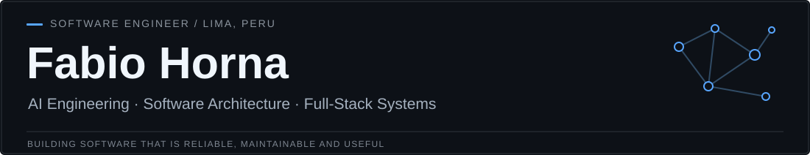
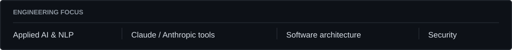
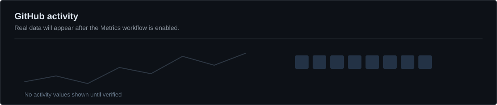
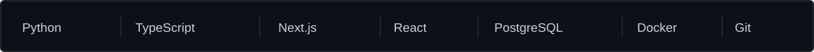

  <picture><source media="(max-width: 600px)" srcset="./assets/hero-mobile.svg" /></picture>

I build **intelligent software systems** with an emphasis on applied AI, dependable architectures, and end-to-end engineering. My work connects data processing, automation, software security, and practical product delivery.

  <picture><source media="(max-width: 600px)" srcset="./assets/focus-mobile.svg" /></picture>

### Selected work

| Project | Engineering focus |
| :-- | :-- |
| **Afluye** | Media intelligence, NLP, event monitoring and automated analysis. |
| **AlphaGraph** | Sugiyama-based graph layout and automated software diagrams. |
| **B2GO** | Web engineering, digital products and business integrations. |

### GitHub metrics

Generated with [lowlighter/metrics](https://github.com/lowlighter/metrics) after setup. No illustrative numbers are presented as real activity.

### Technology stack

<picture><source media="(max-width: 600px)" srcset="./assets/stack-mobile.svg" /></picture>

<b>Engineering approach</b>

- **AI:** information extraction, NLP pipelines and model evaluation.
- **Systems:** reliable APIs, software architecture and maintainability.
- **Quality:** automated testing, security controls and observability.

AI Engineering · Software Architecture · Reliable Systems

